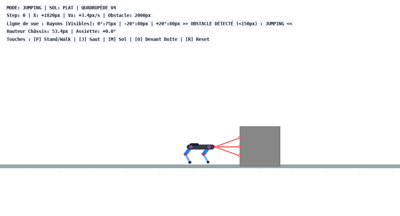
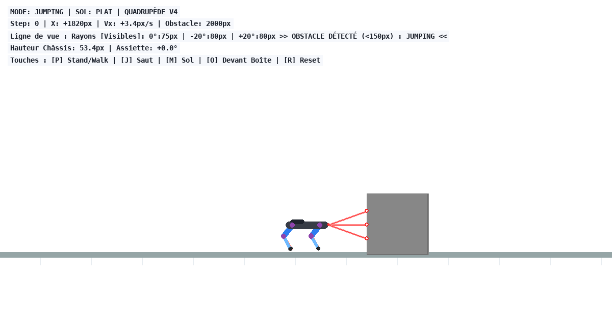
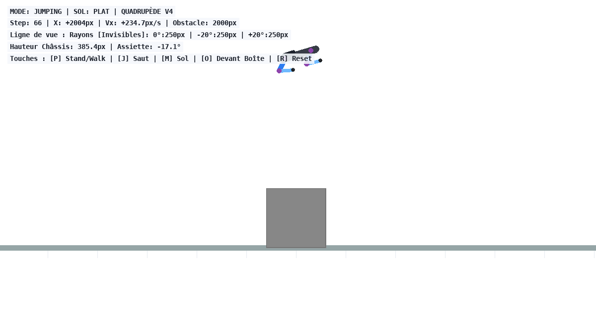

# ParkourRL 🐕⚡

<p align="center">
  
</p>

ParkourRL is a 2D physics-based simulation and Reinforcement Learning (PPO) platform for quadruped robots (modeled after Boston Dynamics Spot and Unitree Go1). It trains and evaluates autonomous locomotion policies—from steady posture and walking on flat or rough terrain, to perception-driven parkour jumping over high obstacles.

---

## Key Features

- **Realistic 2D Quadruped Dynamics**:
  - Accurate physical modeling built on **PyMunk** and **Pygame**.
  - 8 Degrees of Freedom (DoF): 4 hip joints and 4 backwards-oriented knees replicating modern quadruped robot morphology.
  - Closed-loop PD position control with joint torque limits and rate limiting.
- **Hierarchical Locomotion Policies (PPO)**:
  - **`Standing`**: Balance maintenance, body orientation control, and height preservation.
  - **`Walking`**: Forward locomotion with Central Pattern Generator (CPG) target angles, foot clearance, and rough terrain adaptation.
  - **`Jumping`**: A 4-phase dynamic jump controller (Crouch $\to$ High-Torque Thrust $\to$ Flight with Gyro Stabilization $\to$ Compliant Landing) allowing the robot to jump over 120 px obstacles.
- **LiDAR-style Ray Perception**:
  - 3 forward-facing vision rays ($0^\circ, +20^\circ, -20^\circ$) scanning up to 150 px.
  - Automatic obstacle detection triggers seamless transitions from walking to jumping and back to walking post-landing.
- **Interactive Real-time Evaluation**:
  - Live Pygame rendering with camera tracking, velocity HUD, raycasting visualization, and terrain toggles.

---

## Repository Structure

```text
ParkourRL/
├── assets/                     # Visual illustrations & simulation recordings
│   ├── simulation.gif          # Real-time animated simulation recording
│   ├── simulation_jump.png     # High-power jump overflight capture
│   └── simulation_detection.png# 3-ray LiDAR vision detection capture
├── V4/                         # Latest state-of-the-art implementation
│   ├── Env.py                  # PyMunk 2D simulation environment, robot anatomy & rewards
│   ├── Evaluate.py             # Interactive visualization and multi-policy runner
│   ├── Train.py                # PPO reinforcement learning training loop
│   ├── Models.py               # Actor-Critic neural networks (ActorCritic & ContinuousPolicy)
│   ├── RolloutBuffer.py        # Rollout buffer for PPO trajectory storage
│   ├── models/                 # Pretrained PyTorch weights
│   │   ├── ppo_standing.pth    # Standing policy weights
│   │   ├── ppo_walking.pth     # Walking policy weights
│   │   └── ppo_jumping.pth     # Jumping policy weights
│   └── paper_images/           # Morphology and reference figures
├── V1/                         # Initial prototype & limb experimentation
├── V2/                         # Quadruped stabilization & walking baseline
├── V3/                         # Neural architecture scaling & reward tuning
├── requirements.txt            # Python dependencies
└── README.md
```

---

## 🚀 Quick Start

### 1. Installation

Clone the repository and install dependencies:

```bash
git clone https://github.com/444Atlas/ParkourRL.git
cd ParkourRL
pip install -r requirements.txt
```

### 2. Run Interactive Evaluation (V4)

Launch the real-time simulation with trained models:

```bash
cd V4
python Evaluate.py
```

### 3. Interactive Controls

When the simulation window is open, use the following keybindings:

| Key | Action |
|:---|:---|
| **`[P]`** | Toggle between **Standing** and **Walking** mode |
| **`[J]`** | Trigger a **Manual Jump** sequence |
| **`[M]`** | Toggle between **Flat Ground** and **Rough Terrain** |
| **`[O]`** | Teleport robot 250 px before the next obstacle |
| **`[→]` / `[←]`** | Apply lateral perturbation forces to robot torso |
| **`[R]` / `[Space]`** | Reset episode |

---

## Training Custom Policies

To train a policy from scratch or fine-tune an existing model:

```bash
cd V4
# Train walking policy
python Train.py --mode walking --steps 100000

# Train standing policy
python Train.py --mode standing --steps 50000

# Train jumping policy
python Train.py --mode jumping --steps 50000
```

---

## Technical Overview

### Vision & Autonomous Obstacle Clearance

<p align="center">
  
  
</p>

```
  [ Head ]
     \  +20°  -------->  (Range: 150 px)
      -- 0°   -------->  [ Obstacle Box ]  ==> Auto-triggers Jump Sequence
     /  -20°  -------->  (120 x 120 px)
```

1. **Detection**: When all 3 rays strike an obstacle within 150 px, the robot immediately switches from `walking` to `jumping`.
2. **Crouch**: Knees flex to lower center of gravity and compress virtual springs.
3. **Thrust**: Motors deliver high torque ($950\,000\,\text{N}\cdot\text{px}$) with knee $K_p = 1\,150\,000$ to launch the body upward.
4. **Flight**: Active attitude gyro stabilization counters pitch oscillations.
5. **Landing & Resume**: Upon foot contact, compliance control absorbs the impact and the robot immediately resumes autonomous forward walking.

---

## License & Acknowledgments

Developed by **Paul Laurent-Verleye** as part of advanced reinforcement learning and robotics research.
Built with Python, PyMunk, Pygame, and PyTorch.

